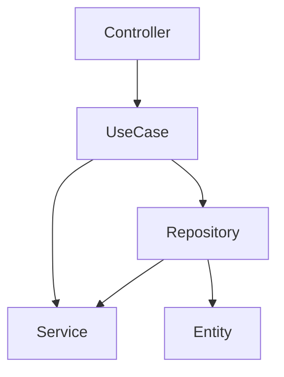

# Implements Clean Architecture with PHP

[](https://packagist.org/packages/giacomomasseron/php-clean-architecture)
[](https://github.com/giacomomasseron/php-clean-architecture/actions?query=workflow%3Arun-tests+branch%3Amain)
[](https://github.com/giacomomasseron/php-clean-architecture/actions?query=workflow%3A"Fix+PHP+code+style+issues"+branch%3Amain)
[](https://packagist.org/packages/giacomomasseron/php-clean-architecture)

Implements Clean Architecture as described by Robert C. Martin (Uncle Bob) here:      
[Clean Architecture](https://blog.cleancoder.com/uncle-bob/2012/08/13/the-clean-architecture.html)

This is an opinionated package that defines levels of the architecture and the dependencies between them.    
And uses deptrac to check if the levels are respected.

- [Installation](#installation)
- [Getting started](#Getting-started)
  - [Commands](#Commands)
    - [Install](#Install) 
    - [Check](#Check)
    - [Rector](#Rector)
    - [Make Entity](#Make-Entity)
    - [Make Repository](#Make-Repository)
    - [Make UseCase](#Make-UseCase)
    - [Make Controller](#Make-Controller)
    - [Make Service](#Make-Service)
- [Why Clean Architecture](#Why-Clean-Architecture)
- [Concepts](#Concepts)
  - [Architecture Level](#Architecture-Level)
  - [UseCase](#UseCase)
- [How it works](#How-it-works)
  - [Levels](#Levels)
  - [Define a level inside the project](#Define-a-level-inside-the-project)
  - [UseCases](#UseCases)
    - [BaseUseCase](#BaseUseCase)
    - [Dependency injection](#dependency-injection)
    - [Events](#events)
- [CI/CD](#CICD)
- [Testing](#testing)
- [Frameworks](#frameworks)
  - [Laravel](#laravel)
    - [Pulse](#pulse) 

## Installation

You can install the package via composer:

```bash  
composer require giacomomasseron/php-clean-architecture
```  
  
After the installation, you must run the *install* command to publish the *deptrac.yaml*, *php-clean-architecture.yaml* and *rector.php* config files to your root folder:  

```bash  
vendor/bin/php-clean-architecture install
```  
  
## Getting started  
  
To check the architecture levels in your project, use the following command:  
  
```bash  
vendor/bin/php-clean-architecture check
```  
  
### Commands  

All make commands read the *php-clean-architecture.yaml* config file to know where to put the files created and which namespace they belong to.

#### Install

The install command publishes needed files your root folder.  
If you have already rector installed, you must add these lines of code in your *rector.php* file: 

```php 
return RectorConfig::configure() // This line is already present in your rector.php file
    ->withConfiguredRule(
        \GiacomoMasseroni\PHPCleanArchitecture\Rector\Rules\AddPHPCleanArchitectureInterfaceControllerToClassesRector::class,
        [
            'targetNamespaces' => [
                'App\Http\Controllers',
            ]
        ]
    )
    ->withConfiguredRule(
        \GiacomoMasseroni\PHPCleanArchitecture\Rector\Rules\AddPHPCleanArchitectureInterfaceEntityToClassesRector::class,
        [
            'targetNamespaces' => [
                'App\Entities',
            ]
        ]
    )
    ->withConfiguredRule(
        \GiacomoMasseroni\PHPCleanArchitecture\Rector\Rules\AddPHPCleanArchitectureInterfaceRepositoryToClassesRector::class,
        [
            'targetNamespaces' => [
                'App\Repositories',
            ]
        ]
    )
    ->withConfiguredRule(
        \GiacomoMasseroni\PHPCleanArchitecture\Rector\Rules\AddPHPCleanArchitectureInterfaceServiceToClassesRector::class,
        [
            'targetNamespaces' => [
                'App\Services',
            ]
        ]
    )
    ->withConfiguredRule(
        \GiacomoMasseroni\PHPCleanArchitecture\Rector\Rules\AddPHPCleanArchitectureInterfaceUseCaseToClassesRector::class,
        [
            'targetNamespaces' => [
                'App\UseCases',
            ]
        ]
    )
```  

#### Check

The check command checks the architecture levels in your project.  
You can use it in your CI/CD pipeline to be sure that the architecture levels are respected.  
  

#### Rector  

The *rector* command adds the needed interfaces to your classes based on namespaces defined in your config files.

#### Make Entity  
  
To create an Entity, you can use the following command:  
  
```bash  
vendor/bin/php-clean-architecture make:entity EntityInYourProject
```  
  
#### Make Repository  
  
To create a Repository, you can use the following command:  
  
```bash  
vendor/bin/php-clean-architecture make:repository UserRepository
```  
  
#### Make UseCase  
  
To create a UseCase, you can use the following command:  
  
```bash  
vendor/bin/php-clean-architecture make:use-case DoSomethingUseCase
```  
  
#### Make Controller  
  
To create a Controller, you can use the following command:  
  
```bash  
vendor/bin/php-clean-architecture make:controller UserController
```  
  
#### Make Service  
  
To create a Service, you can use the following command:  
  
```bash  
vendor/bin/php-clean-architecture make:service ThirdyPartyService  
vendor/bin/php-clean-architecture make:service ThirdyParty
```  
  
In both cases, the created class will be named *ThirdyPartyService*.  
  
## Why Clean Architecture?  
  
Why not?    
It is a well-known, well-structured architecture system.  
  
## Concepts  
  
### Architecture Level  
  
In the Clean Architecture, a level is a layer of the architecture with a specific function, **only connected to the upper level**.  
  
The rule of thumb of the Clean Architecture is:    
**An inner circle must never know anything about the circles around it**.  
  
### UseCase  
  
UseCase is a concept of Use Cases level.  
  
A UseCase is every action your project performs.    
Good examples of use cases are:  
- Login  
- Register  
- CompleteOrder  
- UpdateProfile  
  
**A use case should be a single, very specific action. It shouldn’t do anything more than its name suggests.**  
  
## How it works  
  
The package uses [deptrac](https://github.com/deptrac/deptrac) to define the levels and to check the dependencies between them.  
  
### Levels  
  
These are the levels defined:  
  
- Entity  
- Repository  
- UseCase  
- Controller  
- Service  
  
These are the dependencies between the levels:  
  


The *Entity* level must not depend on any other level.    
The *Repository* level can only depend on *Entity* or *Service* levels.    
The *UseCase* level can only depend on *Repository* or *Service* levels.    
The *Controller* level can only depend on *UseCase* levels.

**What is the Service level?**  
The Service level can be used for third-party tools or libraries.

### Define a level inside the project

The package comes with these interfaces:

- **EntityInterface**: implement this interface if the class belongs to the Entity level.
- **RepositoryInterface**: implement this interface if the class belongs to the Repository level.
- **UseCaseInterface**: implement this interface if the class belongs to the UseCase level.
- **ControllerInterface**: implement this interface if the class belongs to the Controller level.
- **ServiceInterface**: implement this interface if the class belongs to the Service level.


If you want your controller to be part of the Controller level, you need to implement the ControllerInterface.    
For example:

```php  
use GiacomoMasseroni\PHPCleanArchitecture\Contracts\ControllerInterface;  
  
final class YourController implements ControllerInterface  
```  

### UseCases

When you create a UseCase, the class needs to extend the BaseUseCase class, and you need to implement the UseCaseInterface.  
For example:

```php  
use GiacomoMasseroni\PHPCleanArchitecture\BaseUseCase;  
use GiacomoMasseroni\PHPCleanArchitecture\Contracts\UseCaseInterface;  
  
final class DoSomething extends BaseUseCase implements UseCaseInterface  
{  
    public function handle(...$arguments): mixed
    { 
        // 
    }
}  
```  

To execute the UseCase, you need to call the *run* method defined in the BaseUseCase class:

```php  
DoSomething::run($arg1, $arg2);  
```  

If the UseCase has dependencies, declare them in its constructor and call *run* on the instance built by your container, see [Dependency injection](#dependency-injection).

#### BaseUseCase

The package defines an abstract class for use cases: *BaseUseCase*.    
This class defines variable for the user executing the use case:

```php  
UseCaseExecutorInterface $executor
```   

You can set the executor using the following example:  
  
```php  
DoSomething::actingAs($user)->run($arg1, $arg2);  
```  

*actingAs* returns the UseCase instance. If you call *run* on it more than once, the runs share that instance: the executor, `$data` and any other property set by an earlier run are still there for the next run and its *rollback*.

If you need to rollback the use case, you can override the *rollback* method:

```php  
public function rollback(): void  
{  
}  
```  

#### Dependency injection

A UseCase can declare its dependencies in its constructor, so your container (Laravel, Symfony, ...) builds it and injects it where it is needed:

```php
use GiacomoMasseroni\PHPCleanArchitecture\BaseUseCase;
use GiacomoMasseroni\PHPCleanArchitecture\Contracts\UseCaseInterface;
use InvalidArgumentException;

final class CreateUser extends BaseUseCase implements UseCaseInterface
{
    public function __construct(private readonly UserRepository $users) {}

    public function handle(mixed ...$arguments): mixed
    {
        $name = $arguments[0] ?? null;

        // the arguments arrive as mixed: check them before passing them to the typed method
        if (!is_string($name)) {
            throw new InvalidArgumentException('CreateUser expects the user name');
        }

        return $this->create($name);
    }

    // mixed, not User: the UseCase level must not depend on the Entity level
    private function create(string $name): mixed
    {
        return $this->users->create($name);
    }
}
```

The controller receives the UseCase in its constructor and calls *run* on it:

```php
use GiacomoMasseroni\PHPCleanArchitecture\Contracts\ControllerInterface;

final class UserController implements ControllerInterface
{
    public function __construct(private readonly CreateUser $createUser) {}

    public function store(string $name): void
    {
        $user = $this->createUser->run($name);
    }
}
```

Calling *run* on the instance, or invoking it (`($this->createUser)($name)`), dispatches the same [events](#events) and calls *rollback* the same way as the static call.

If your project uses [phpstan-strict-rules](https://github.com/phpstan/phpstan-strict-rules), it reports `$this->createUser->run($name)` as a dynamic call to a static method (`staticMethod.dynamicCall`), because *run* is declared static for `DoSomething::run()`. Invoke the instance instead: `($this->createUser)($name)` does the same.

The rules:

- The static `DoSomething::run()` and `DoSomething::actingAs()` only work when the UseCase has no required constructor parameters (a private or protected constructor is fine). Otherwise they throw `UseCaseNotStaticallyRunnableException`: build the UseCase with your container and call *run* on the instance.  
  This exception reports a mistake in your code, not bad input, but it extends `PHPCleanArchitectureException` (code 400) like the package's other exceptions: thrown inside another UseCase's *handle*, it runs that UseCase's *rollback*, and if your app turns `PHPCleanArchitectureException` into a 4xx response, exclude this one.
- On an injected instance, set the public `executor` property, or pass the actor as an argument of *run*:
    ```php
    $this->createUser->executor = $currentUser;
    $user = $this->createUser->run($name);
    ```
  The executor stays set on that instance, and so does everything else an earlier *run* left on it, such as `$data`, which the next *run* and its *rollback* see. If your container shares the instance (Symfony services are shared by default), pass the actor as an argument instead of setting `executor`, and reset any per-run state at the start of *handle*, or declare the UseCase as a non-shared service.
- Never call *handle* directly: it skips the events and the rollback.

#### Events

The package dispatches two events, one when the use case starts, and one when the use case ends.  
It uses the [Symfony Event Dispatcher Component](https://symfony.com/doc/current/components/event_dispatcher.html).

The events are:

- UseCaseStartedEvent
- UseCaseCompletedEvent

## CI/CD

If you want to check the architecture levels in your CI/CD pipeline, you can use the following command:

```bash  
vendor/bin/php-clean-architecture check
```  
  
This command will stop your pipeline if there are architecture violations, based on the deptrac configuration file.  

## Testing

```bash  
composer test
```  

## Frameworks

### Laravel

[I wrote an article on how to use this package with Laravel](https://dev.to/giacomomasseron/clean-architecture-in-a-laravel-project-3oh3)

#### Pulse

Laravel pulse is a package that helps you to monitor the health of your Laravel application.  
If you want to monitor use cases execution time, you can:

- Create two laravel events, ```UseCaseStarted``` and ```UseCaseCompleted```
- Create a Pulse card that listens to these events and measures the execution time.
- Add this code to ```register``` function in ```AppServiceProvider.php``` file:
    ```php 
    \GiacomoMasseroni\PHPCleanArchitecture\Dispatcher::getInstance()->addListener(\GiacomoMasseroni\PHPCleanArchitecture\Events\UseCaseStartedEvent::class, function (\GiacomoMasseroni\PHPCleanArchitecture\Events\UseCaseStartedEvent $event): void {
        // Just propagate the event to Laravel event system
        \App\Events\UseCaseStarted::dispatch($event->useCase);
    });
    
    \GiacomoMasseroni\PHPCleanArchitecture\Dispatcher::getInstance()->addListener(\GiacomoMasseroni\PHPCleanArchitecture\Events\UseCaseCompletedEvent::class, function (\GiacomoMasseroni\PHPCleanArchitecture\Events\UseCaseCompletedEvent $event): void {
        // Just propagate the event to Laravel event system
        \App\Events\UseCaseCompleted::dispatch($event->useCase);
    });
    ```


## Changelog  
  
Please see [CHANGELOG](CHANGELOG.md) for more information on what has changed recently.  
  
## Contributing  
  
Please see [CONTRIBUTING](CONTRIBUTING.md) for details.  
  
## Security Vulnerabilities  
  
Please review [our security policy](../../security/policy) on how to report security vulnerabilities.  
  
## Credits  
  
- [Giacomo Masseroni](https://github.com/giacomomasseron)  
- [All Contributors](../../contributors)  
  
## License  
  
The MIT License (MIT). Please see [License File](LICENSE.md) for more information.